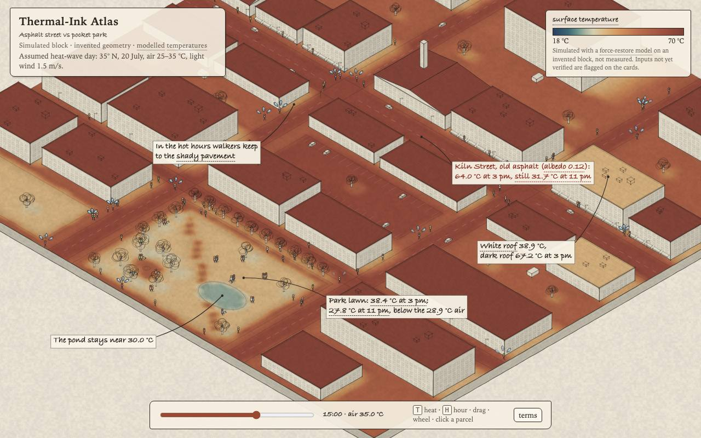

# thermal-ink-atlas

A hand-inked isometric city block that shows urban heat: an old asphalt street
next to a shady pocket park, through one heat-wave day.

Block 2, `cities/sponge-retrofit/index.html`, shows one invented block Before and After a sponge-city and cool-roof retrofit, side by side with a draggable divider (`B` swaps) and a days-since-rain slider.

Live: https://yushengzhou.github.io/thermal-ink-atlas/

The block is simulated and invented (not a real address). Temperatures are
modelled with a simple surface energy-balance model, not measured.



## Open it

- Double-click `cities/asphalt-park/index.html`. It is one offline file.
- Or serve the folder and open <http://localhost:8000/>:

  ```sh
  python3 -m http.server
  ```

## Controls

| Input | Does |
|---|---|
| `T` | thermal view on/off |
| `H` / `Shift+H` | one hour later / earlier |
| slider | pick the hour |
| drag / wheel | pan / zoom |
| click a parcel | heat card (material, temperatures, source) |
| `terms` button | glossary of terms |

## Build and test

```sh
npm ci
npm run build   # rebuilds the single-file HTML and docs/sources.md
npm test        # unit tests and Playwright checks
```

## Model and sources

See [`docs/sources.md`](docs/sources.md) for the model, parameters and
citations. Values not yet checked against a primary source are flagged
*unverified* there and on the heat cards.

## Licence

MIT, see [`LICENSE`](LICENSE).
