# Thermal-Ink Atlas

**English** · [中文](#中文)

<p align="center">
  <a href="media/thermal-ink-atlas.mp4"></a>
</p>

<p align="center">
  <b><a href="https://yushengzhou.github.io/thermal-ink-atlas/">Open the live atlas</a></b> ·
  <b><a href="media/thermal-ink-atlas.mp4">Watch the 44-second film</a></b> ·
  <a href="https://yushengzhou.github.io/thermal-ink-atlas/references.html">Sources</a>
</p>

Twelve hand-inked city blocks show where a city gets hot on a heat-wave day, and where it stays cool.
Slide through the day, switch on the heat view, and see the asphalt, the shade, the water and the night.

Every block is made up, not a real place. Its temperatures are calculated by a simple model fed with
published measurements; they are not measured.

## Open it

- **Online:** <https://yushengzhou.github.io/thermal-ink-atlas/> and pick a block.
- **Offline:** download the repository and double-click any `cities/<block>/index.html`
  (for example `cities/asphalt-park/index.html`). Each block is one file of under 500 KB
  that needs no internet and no install.

## Keys and buttons

Every key also has a button on the page.

| Key or button | Does |
|---|---|
| `T` or **heat view** | switch between the drawing and the heat view (colours = surface temperature) |
| `H` / `Shift+H`, **+1 h** / **−1 h**, or the slider | move through the day, hour by hour |
| drag, mouse wheel | move around, zoom in and out |
| click a spot | a card with that spot's material, temperatures and sources |
| **terms** | a short glossary; underlined words open their own note |
| `B` (block 2) | swap the Before and After sides |
| `G` / `Shift+G` (block 3) | next / previous glass type |
| `W` / `A` (block 4) | wind lines / the water's effect on the air |
| `P` (block 5) | the 7 pm water splash on or off |
| `G` (block 6) | strokes showing the ground giving back its heat at night |
| `S` / `C` (block 7) | the midwinter shadows the buildings were spaced for / the air conditioners' heat |
| `I` / `U` (block 8) | water the pitch at 2 pm / mark surfaces hot enough to burn skin |
| `K` / `U` (block 9) | who is waiting in sun or shade / handrails and benches hot enough to burn |
| `W` / `O` (block 10) | the roofs residents painted white / the room under a metal roof |
| `C` / `L` (block 11) | the light street coating off / the water each surface uses |
| `Q` / `M` (block 12) | the heat given off by stone, crowd and stalls / close the market |

## The twelve blocks

Each line is what the block's own model shows (the numbers are the ones on its page).

| | Block | What it shows |
|---|---|---|
| <a href="https://yushengzhou.github.io/thermal-ink-atlas/cities/asphalt-park/index.html">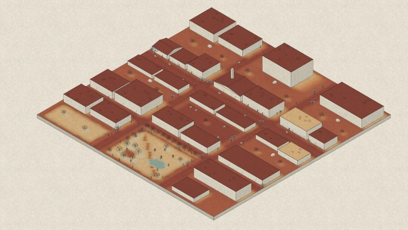</a> | **1 · [Asphalt street vs pocket park](https://yushengzhou.github.io/thermal-ink-atlas/cities/asphalt-park/index.html)** | At 3 pm the old dark road is 64 °C and the park lawn 38 °C. At 11 pm the road is still 32 °C, while the lawn has cooled below the air. |
| <a href="https://yushengzhou.github.io/thermal-ink-atlas/cities/sponge-retrofit/index.html">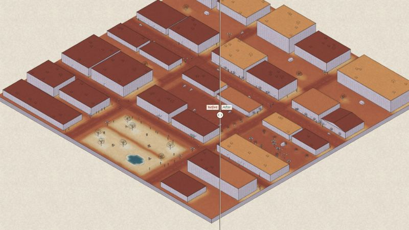</a> | **2 · [Sponge-city and cool-roof retrofit](https://yushengzhou.github.io/thermal-ink-atlas/cities/sponge-retrofit/index.html)** | A dark roof painted white is 48 °C instead of 67 °C at 3 pm. A light road coating cools the road by 2 degrees at noon, but people on it feel 1 degree hotter. |
| <a href="https://yushengzhou.github.io/thermal-ink-atlas/cities/glass-cbd/index.html">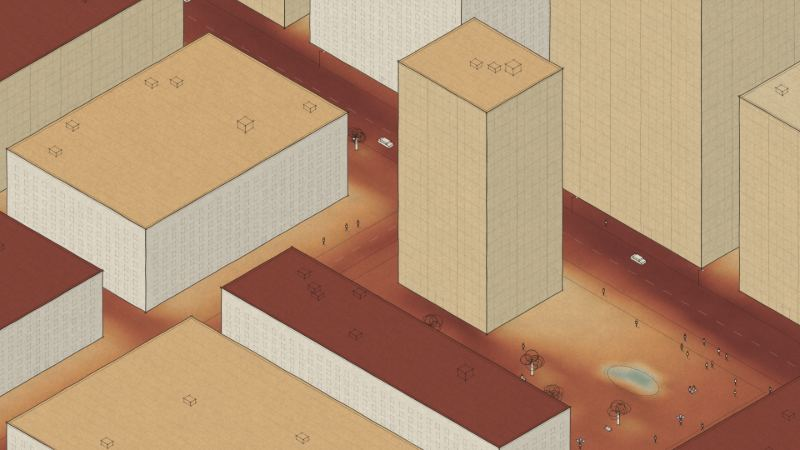</a> | **3 · [Glass towers and street canyons](https://yushengzhou.github.io/thermal-ink-atlas/cities/glass-cbd/index.html)** | Sun bounced off a glass tower makes a patch of shade feel like 51 °C, against 40 °C in plain shade. |
| <a href="https://yushengzhou.github.io/thermal-ink-atlas/cities/waterfront/index.html">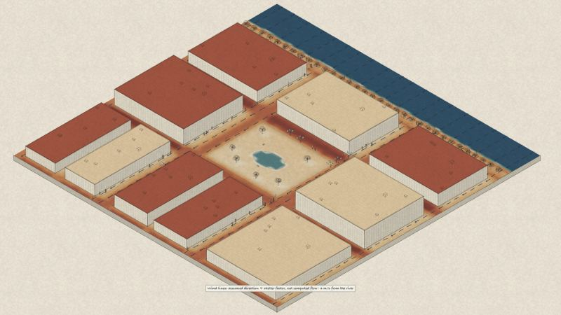</a> | **4 · [Waterfront and wind corridors](https://yushengzhou.github.io/thermal-ink-atlas/cities/waterfront/index.html)** | A street open to the river breeze is 56 °C at 3 pm, one behind the warehouses 67 °C. The river cools the air only within about 70 m. |
| <a href="https://yushengzhou.github.io/thermal-ink-atlas/cities/hutong/index.html">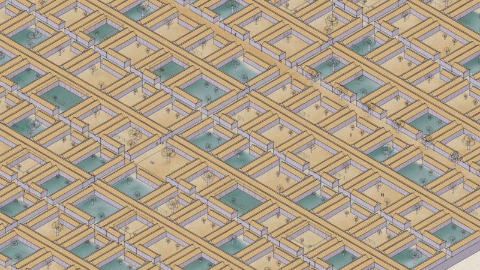</a> | **5 · [Hutong lanes and courtyards](https://yushengzhou.github.io/thermal-ink-atlas/cities/hutong/index.html)** | Water splashed on the lanes at 7 pm leaves them 6 degrees cooler by 8 pm and 5 at 11 pm. Under the summer mat awning (天棚) it feels like 49 °C, in the open courtyard sun 72 °C. |
| <a href="https://yushengzhou.github.io/thermal-ink-atlas/cities/parking/index.html">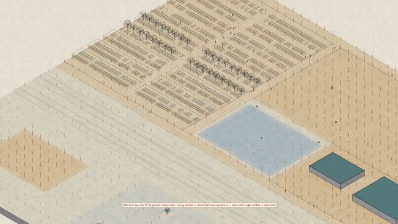</a> | **6 · [Car park and brownfield](https://yushengzhou.github.io/thermal-ink-atlas/cities/parking/index.html)** | Open asphalt is 63 °C at 3 pm and still 31 °C at 11 pm, giving back the day's heat. Under the solar canopy it is 36 °C at 3 pm; the metal sheds cool below the air by night. |
| <a href="https://yushengzhou.github.io/thermal-ink-atlas/cities/estate/index.html">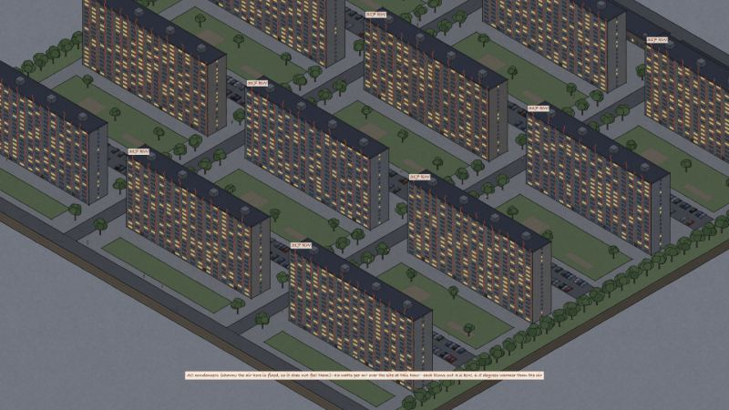</a> | **7 · [Older high-rise estate](https://yushengzhou.github.io/thermal-ink-atlas/cities/estate/index.html)** | The rows are spaced so that every ground-floor window gets at least two hours of midwinter sun; in July a slab's noon shadow reaches only 13 m into the 80 m courtyard. The air conditioners put about 43 W per m² of heat into the evening air (shown, not felt). |
| <a href="https://yushengzhou.github.io/thermal-ink-atlas/cities/campus/index.html">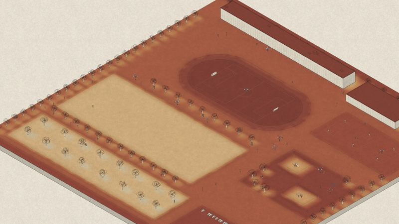</a> | **8 · [School campus playground](https://yushengzhou.github.io/thermal-ink-atlas/cities/campus/index.html)** | Artificial turf is 68 °C at 3 pm, the grass next to it 38 °C. Rubber under a shade sail is 42 °C, in the sun 65 °C. Watering the pitch at 2 pm cools it 6 degrees, and only 4 half an hour later. |
| <a href="https://yushengzhou.github.io/thermal-ink-atlas/cities/busstop/index.html">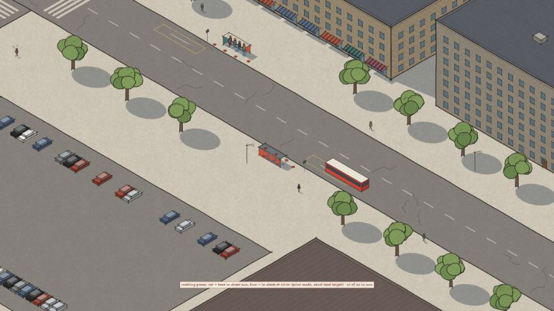</a> | **9 · [Bus stops and footbridges](https://yushengzhou.github.io/thermal-ink-atlas/cities/busstop/index.html)** | In the shade of a metal bus shelter it feels like 36 °C at 3 pm, at the kerb 70 °C. At 5 pm the low sun comes in from the side, where a west screen (43 °C) helps more than a bigger roof (53 °C). |
| <a href="https://yushengzhou.github.io/thermal-ink-atlas/cities/village/index.html">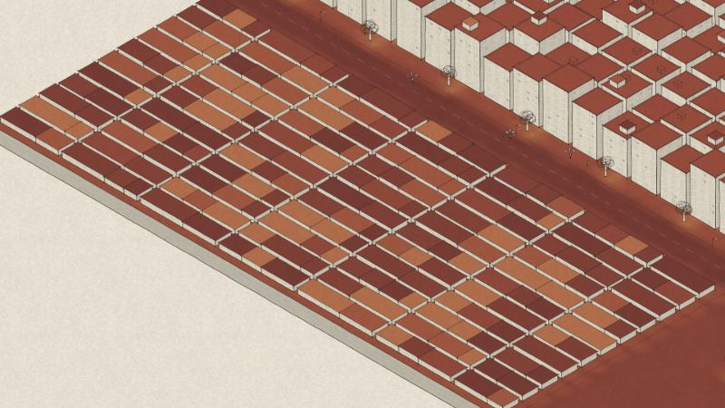</a> | **10 · [Urban village and informal edge](https://yushengzhou.github.io/thermal-ink-atlas/cities/village/index.html)** | Bare rusty iron roofs reach 71 °C at 3 pm, roofs the residents painted white 58 °C. At 10 pm the 1.5–3 m lanes still feel like 34 °C, the open square 29 °C. |
| <a href="https://yushengzhou.github.io/thermal-ink-atlas/cities/desert/index.html">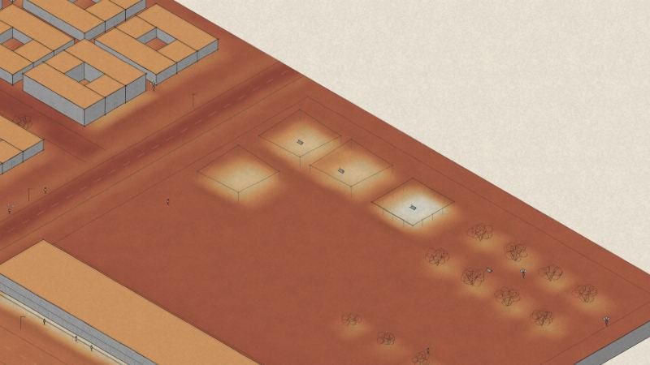</a> | **11 · [Desert courtyard neighbourhood](https://yushengzhou.github.io/thermal-ink-atlas/cities/desert/index.html)** | Under the shade sails it feels about 23 degrees cooler than in the open sun, in the arcade about 27. The watered lawn stays below the air but drinks about 6.5 litres per m² a day. |
| <a href="https://yushengzhou.github.io/thermal-ink-atlas/cities/nightmarket/index.html">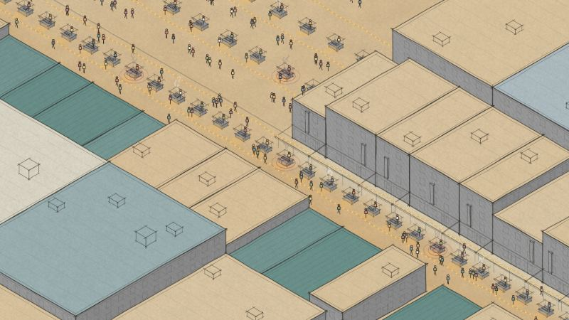</a> | **12 · [Night market street](https://yushengzhou.github.io/thermal-ink-atlas/cities/nightmarket/index.html)** | At 9 pm the granite still gives off about 100 W per m² of the day's heat, and the open square feels 2 degrees cooler than the air. Only next to a charcoal grill is it hot: up to 89 °C felt at 1 m. |

## The film

[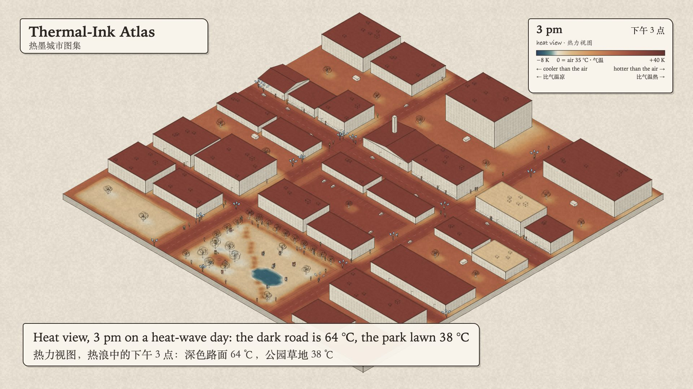](media/thermal-ink-atlas.mp4)

[`media/thermal-ink-atlas.mp4`](media/thermal-ink-atlas.mp4) (44 s, 1920×1080, H.264) was not screen-recorded:
`npm run film` asks the engine for each frame in turn, adds the captions, and encodes the frames in the browser.
Every number in a caption is read from the block's own model output.

## How the model works

Each block is a grid of 5 m cells on one clear heat-wave day. For every hour the engine works out where the
sun is, which cells it reaches past the buildings and trees (shade), and how much open sky each cell sees.
It then balances the energy at every surface: sunshine absorbed, heat radiated to the sky and the walls,
heat carried off by the air, heat soaked into and released from the ground, and water evaporating from grass,
ponds or wet paving. The result is the **surface temperature**, the colour of the heat view. The "feels like"
numbers are the **mean radiant temperature**: how warm the sun and all the surfaces around a person make
them feel. The **air temperature is held fixed** to a heat-wave day curve, not simulated, so nothing in the
atlas warms the air: crowds, cars and air conditioners are shown, not felt.

## Honest limits

The model is simple on purpose, and it misses some published values. The misses are kept, not tuned away,
and each block's page states them on its cards. The full tables are in [`docs/sources.md`](docs/sources.md).

- Block 1: 7 of 19 values fall outside the literature ranges (for example sunlit asphalt a little too hot by
  day and a little too cool at 11 pm).
- Block 2: 3 of 6 acceptance bands and 2 of 4 literature comparisons fall outside (the road coating, the
  permeable pavers right after rain).
- Block 3: 11 of 45 checks fall outside (the reflection spots feel hotter than the studies found, and a deep street's
  shaded floor is too warm).
- Block 4: 6 of 34 checks fall outside (sheltered streets come out hotter than in the studies).
- Block 5: 4 of 26 checks fall outside (grey tile roofs and shaded lane floors too warm).
- Block 6: 6 of 8 bands met; missed: the shed roof's first hour after sunset, and the solar canopy's daily range.
- Block 7: 6 of 7 bands met; missed: how much warmer the shade gets as the sky view grows (a soft band).
- Block 8: 6 of 10 bands met; missed: the sport courts, the sail and tree shade on rubber, and the watered pitch.
- Block 9: 5 of 7 bands met; missed: the opal roof's cut, and the paving under a roof against the air.
- Block 10: 6 of 8 bands met (5 independent of a calibration); missed: asbestos-cement roofs, and the lanes at noon.
- Block 11: 4 of 9 independent bands met; missed: sunlit gravel, the lawn's water, the sails and ramada,
  shade after sunset, and the coating's effect on people; band 7 is semi-constructed and missed.
- Block 12: 4 of 5 independent bands met; missed: the grill's heat at 3 m.

Known engine limits, each with an open issue:
[#20](https://github.com/yushengzhou/thermal-ink-atlas/issues/20) wind measurement height in the
convective coefficient;
[#24](https://github.com/yushengzhou/thermal-ink-atlas/issues/24) the sun's declination is about 0.2° off;
[#28](https://github.com/yushengzhou/thermal-ink-atlas/issues/28) the shared warm-wall term and heat loss
under thin layers;
[#30](https://github.com/yushengzhou/thermal-ink-atlas/issues/30) visual cues (north arrow, walkers,
morning colours);
[#31](https://github.com/yushengzhou/thermal-ink-atlas/issues/31) the retrofit's dry spells, water and upkeep.
Values not yet checked against a primary source are flagged *unverified* in `docs/sources.md` and on the cards.

## References

Temperatures come from a simple model fed with parameters from the literature, not from measurements. The
full list, grouped by block with DOIs and reading status, is
[`references.html`](https://yushengzhou.github.io/thermal-ink-atlas/references.html)
([source](references.html), generated by `npm run build`). The model, every parameter and its citation are in
[`docs/sources.md`](docs/sources.md).

Key sources per block:

- All blocks (model): Deardorff 1978 (force-restore); NOAA solar equations; Brutsaert 1975 (sky emissivity);
  Oke 1987/2017 (surface properties); Lindberg et al. 2008 (SOLWEIG, Tmrt).
- Block 1, `asphalt-park`: Pomerantz et al. 2000 (LBNL-43442); US EPA 2008 / 2012 heat-island compendium;
  Melnikov et al. 2022 (shade-seeking walkers).
- Block 2, `sponge-retrofit`: Santamouris 2014; Li, Harvey et al. 2013 (permeable pavements); Middel et al.
  2020 (reflective pavement); Ko et al. 2022; State Council 2015 sponge-city guideline.
- Block 3, `glass-cbd`: Oke 1981 (canyon geometry); Johansson 2006 (Fez); EnergyPlus window angular
  properties; Du et al. 2025 (Chengdu reflection zones); Speroni et al. 2022 (abstract only).
- Block 4, `waterfront`: Völker et al. 2013; Hathway & Sharples 2012 (secondary); Jacobs et al. 2020;
  Solcerova et al. 2019 (night pond); BoM apparent temperature (Steadman 1994).
- Block 5, `hutong`: Hendel et al. 2015 and 2016 (pavement watering, Paris); Takebayashi et al. 2023 (Kobe);
  Lin et al. 2019 (Harbin courtyards); Johansson 2006 (Fez); Deng Yunxiang, 天棚遮阴 (the mat awning).
- Block 6, `parking`: Golden et al. 2007 (PV canopy, Phoenix); Stempihar et al. 2012 (pavement thickness);
  Takebayashi & Moriyama 2009 (grass parking); Scott, Simpson & McPherson 1999 (lot trees); Vanos et al. 2018
  and McLaren, Null & Quinn 2005 (hot cars).
- Block 7, `estate`: GB 50180-2018 (the 大寒 sunlight rule; table values unverified); Lai, Maing & Ng 2017
  (Tmrt and sky view in shade, Hong Kong); Cai & Hu 2017 (paving vs grass, Wuhan); Mu et al. 2025 (condenser
  exhaust, Changsha); Bruelisauer et al. 2014 (condenser stacks, Singapore).
- Block 8, `campus`: Jim 2016 and 2017 (turf vs grass, Hong Kong); Singh et al. 2024 (review of 23 turf
  studies); Vanos et al. 2016 and 2017 (playgrounds, shade sails); Pfautsch et al. 2020 (school shade, New
  South Wales); McNitt et al. 2008 (watering turf); ISO 13732-1 via CENELEC Guide 29 (contact-burn limits;
  unverified).
- Block 9, `busstop`: Dzyuban et al. 2022 (Phoenix bus stops); Middel et al. 2021 (shade and Tmrt, Tempe);
  Lanza et al. 2025 (Houston stops, glass shelters); Chen et al. 2024 (covered walkway, Hong Kong); Hong Kong
  Highways Department BS/GN/047 (shelter guidance); a polycarbonate datasheet (transmission); ISO 13732-1 via
  CENELEC Guide 29. Most were read through the research brief and are flagged unverified.
- Block 10, `village`: Guo et al. (Pingshan traverses, Shenzhen); Wu et al. 2015/2017 and Yi et al. 2022
  (Shenzhen urban villages); Deng et al. 2023 (Guangzhou old blocks); Scott et al. 2017 (Nairobi);
  Tasgaonkar et al. 2022, Vellingiri et al. 2020 and Wilby et al. 2021 (rooms under metal roofs, cool roofs);
  Nutkiewicz et al. 2022; Ma et al. 2015 and Hess et al. 2018 (heat and mortality). Most were read through
  the research brief and are flagged unverified.
- Block 11, `desert`: NOAA NCEI climate normals and AZMET (the design day); Middel et al. 2021 and Middel &
  Krayenhoff 2019 (shade and Tmrt, Tempe); Colter et al. 2019 (ramadas and trees); the Phoenix cool-pavement
  pilot (2024) and Erell et al. 2014 (light paving); AZ1195 and AMWUA (lawn and tree water); Gober et al. 2010,
  Middel et al. 2014 and 2015 (water, landscaping, canopy); Vanos et al. 2022 and Huang et al. 2025 (misters);
  Maricopa County public health (heat deaths). Most were read through the research brief and are flagged
  unverified.
- Block 12, `nightmarket`: Central Weather Administration (Taiwan) climate normals 1991–2020, Taipei (the
  design evening); Yang & Zhao 2016 (pavements in a hot-humid city); Doulos, Santamouris & Livada 2004 (paving
  materials); ASHRAE Standard 55 and ISO 8996 (body heat of the crowd); Sailor (heat from human activity);
  Still and NSW Government guidance (crowd density); equipment vendors (grill and stall heat); Taipei City
  Government (Shilin Night Market). Reading status for each is in `references.html`.

## Development

```sh
npm ci
npm run build   # rebuilds the single-file pages, docs/sources.md and references.html
npm test        # unit tests and Playwright checks (what CI runs)
npm run film    # re-renders media/ (about a minute; not part of npm test or CI)
npm run film -- --check   # renders a few film frames twice and compares their hashes
```

`npm run film` drives the built pages in headless Chromium through their determinism contract
(`atlas.seek(frame, camera)` and the `?f`, `?cam`, `?thermal`, `?hour` query modes), draws the captions on a
canvas, encodes H.264 with WebCodecs and writes the MP4 with a small muxer in
[`scripts/film.mjs`](scripts/film.mjs); no ffmpeg is needed. Nothing in `media/` is used by the pages.

## Licence

MIT, see [`LICENSE`](LICENSE).

---

# 中文

[English](#thermal-ink-atlas) · **中文**

<p align="center">
  <a href="media/thermal-ink-atlas.mp4"></a>
</p>

<p align="center">
  <b><a href="https://yushengzhou.github.io/thermal-ink-atlas/">打开在线图集</a></b> ·
  <b><a href="media/thermal-ink-atlas.mp4">观看 44 秒宣传短片</a></b> ·
  <a href="https://yushengzhou.github.io/thermal-ink-atlas/references.html">文献</a>
</p>

热墨城市图集用十二个手绘街区，展示热浪中的一天里城市哪里会变热、哪里能保持凉爽。
拖动时间、打开热力视图，就能看到沥青、树荫、水面和夜晚各自的变化。

所有街区都是虚构的，并非真实地点。图中的温度由一个简化模型根据已发表的测量数据计算得出，并非实测。

## 怎么打开

- **在线：** <https://yushengzhou.github.io/thermal-ink-atlas/>，选一个街区即可。
- **离线：** 下载本仓库，双击任意 `cities/<街区>/index.html`（例如 `cities/asphalt-park/index.html`）。
  每个街区都是一个不到 500 KB 的独立文件，无需联网，也无需安装。

## 按键与按钮

每个按键在页面上都有对应的按钮。

| 按键或按钮 | 作用 |
|---|---|
| `T` 或 **heat view** | 在线描图和热力视图之间切换（颜色表示地表温度） |
| `H` / `Shift+H`、**+1 h** / **−1 h** 或滑块 | 按小时前后移动时间 |
| 拖动、鼠标滚轮 | 平移、缩放 |
| 点击某处 | 弹出卡片：该处的材料、温度和文献来源 |
| **terms** | 简短术语表；带下划线的词可单独展开解释 |
| `B`（街区 2） | 交换改造前 / 改造后两侧 |
| `G` / `Shift+G`（街区 3） | 切换下一种 / 上一种玻璃 |
| `W` / `A`（街区 4） | 风线 / 水面对空气的影响 |
| `P`（街区 5） | 傍晚 7 点泼水：开或关 |
| `G`（街区 6） | 显示地面在夜里放热的笔触 |
| `S` / `C`（街区 7） | 楼距所依据的大寒日阴影 / 空调外机的排热 |
| `I` / `U`（街区 8） | 下午 2 点给球场浇水 / 标出烫到会灼伤皮肤的表面 |
| `K` / `U`（街区 9） | 候车的人站在阳光下还是阴影里 / 会烫伤人的扶手和座椅 |
| `W` / `O`（街区 10） | 居民刷白的屋顶 / 铁皮屋顶下的房间 |
| `C` / `L`（街区 11） | 去掉浅色路面涂层 / 每种地面的用水量 |
| `Q` / `M`（街区 12） | 石材、人群和摊位散发的热 / 收市 |

## 十二个街区

每行写的是该街区自身模型给出的结果（数字与页面上的一致）。

| | 街区 | 看点 |
|---|---|---|
| <a href="https://yushengzhou.github.io/thermal-ink-atlas/cities/asphalt-park/index.html"></a> | **1 · [沥青街道与口袋公园](https://yushengzhou.github.io/thermal-ink-atlas/cities/asphalt-park/index.html)** | 下午 3 点，老旧深色路面 64 °C，公园草地 38 °C。晚上 11 点路面仍有 32 °C，而草地已经凉到低于气温。 |
| <a href="https://yushengzhou.github.io/thermal-ink-atlas/cities/sponge-retrofit/index.html"></a> | **2 · [海绵城市与凉屋顶改造](https://yushengzhou.github.io/thermal-ink-atlas/cities/sponge-retrofit/index.html)** | 深色屋顶刷白后，下午 3 点从 67 °C 降到 48 °C。浅色路面涂层让中午的路面凉 2 度，路上行人却觉得热了 1 度。 |
| <a href="https://yushengzhou.github.io/thermal-ink-atlas/cities/glass-cbd/index.html"></a> | **3 · [玻璃塔楼与街道峡谷](https://yushengzhou.github.io/thermal-ink-atlas/cities/glass-cbd/index.html)** | 玻璃幕墙反射的阳光落进阴影里，那一片体感像 51 °C，普通阴影只有 40 °C。 |
| <a href="https://yushengzhou.github.io/thermal-ink-atlas/cities/waterfront/index.html"></a> | **4 · [滨水区与通风廊道](https://yushengzhou.github.io/thermal-ink-atlas/cities/waterfront/index.html)** | 下午 3 点，迎着河风的街道 56 °C，仓库背后避风的街道 67 °C。河水只能让约 70 米以内的空气变凉。 |
| <a href="https://yushengzhou.github.io/thermal-ink-atlas/cities/hutong/index.html"></a> | **5 · [胡同与四合院](https://yushengzhou.github.io/thermal-ink-atlas/cities/hutong/index.html)** | 傍晚 7 点往胡同泼水，到 8 点地面凉 6 度，到 11 点仍凉 5 度。天棚下体感 49 °C，院子里晒太阳处 72 °C。 |
| <a href="https://yushengzhou.github.io/thermal-ink-atlas/cities/parking/index.html"></a> | **6 · [停车场与棕地](https://yushengzhou.github.io/thermal-ink-atlas/cities/parking/index.html)** | 露天沥青下午 3 点 63 °C，晚上 11 点仍有 31 °C，正把白天的热放出来。光伏车棚下午 3 点 36 °C；铁皮棚夜里会凉到低于气温。 |
| <a href="https://yushengzhou.github.io/thermal-ink-atlas/cities/estate/index.html"></a> | **7 · [老旧高层住宅小区](https://yushengzhou.github.io/thermal-ink-atlas/cities/estate/index.html)** | 楼距保证每个底层窗台在大寒日至少有两小时日照；而七月正午，板楼的影子只伸进 80 米宽的院子 13 米。空调外机在傍晚向空气排热，约每平方米 43 瓦（只显示，不计入体感）。 |
| <a href="https://yushengzhou.github.io/thermal-ink-atlas/cities/campus/index.html"></a> | **8 · [校园操场](https://yushengzhou.github.io/thermal-ink-atlas/cities/campus/index.html)** | 下午 3 点人造草坪 68 °C，旁边的真草地 38 °C。遮阳帆下的塑胶地面 42 °C，太阳下 65 °C。下午 2 点给球场浇水能凉 6 度，半小时后只剩 4 度。 |
| <a href="https://yushengzhou.github.io/thermal-ink-atlas/cities/busstop/index.html"></a> | **9 · [公交站与人行天桥](https://yushengzhou.github.io/thermal-ink-atlas/cities/busstop/index.html)** | 下午 3 点，金属顶棚的阴影下体感 36 °C，路边 70 °C。下午 5 点低角度的太阳从侧面照进来，这时西侧挡板（43 °C）比加大顶棚（53 °C）更管用。 |
| <a href="https://yushengzhou.github.io/thermal-ink-atlas/cities/village/index.html"></a> | **10 · [城中村与简易房边缘](https://yushengzhou.github.io/thermal-ink-atlas/cities/village/index.html)** | 下午 3 点，裸露的生锈铁皮屋顶达 71 °C，居民刷白的屋顶 58 °C。晚上 10 点，1.5–3 米宽的窄巷体感仍有 34 °C，开阔广场 29 °C。 |
| <a href="https://yushengzhou.github.io/thermal-ink-atlas/cities/desert/index.html"></a> | **11 · [沙漠庭院街区](https://yushengzhou.github.io/thermal-ink-atlas/cities/desert/index.html)** | 遮阳帆下体感比烈日下凉约 23 度，拱廊下约 27 度。浇水的草坪温度低于气温，但每平方米每天要喝掉约 6.5 升水。 |
| <a href="https://yushengzhou.github.io/thermal-ink-atlas/cities/nightmarket/index.html"></a> | **12 · [夜市街道](https://yushengzhou.github.io/thermal-ink-atlas/cities/nightmarket/index.html)** | 晚上 9 点，花岗岩路面每平方米仍在放出约 100 瓦白天存下的热，开阔广场的体感比气温低 2 度。只有炭火烤炉旁才真正热：1 米处体感最高约 89 °C。 |

## 宣传短片

[`media/thermal-ink-atlas.mp4`](media/thermal-ink-atlas.mp4)（44 秒，1920×1080，H.264）不是录屏：
`npm run film` 逐帧向引擎要画面，叠加字幕，再在浏览器里编码。字幕里的每个数字都读自该街区自身的模型输出。

## 模型怎么算

每个街区是一张 5 米网格，模拟晴朗热浪中的一天。引擎逐小时算出太阳的位置、阳光越过楼房和树木能照到哪些格子（阴影），
以及每个格子能看到多少天空。然后在每个表面上做能量平衡：吸收的阳光、向天空和墙面辐射出去的热、被空气带走的热、
渗入地面又放出来的热，以及草地、水面或湿路面蒸发的水。结果就是 **地表温度**，也就是热力视图的颜色。
"体感"数字指的是 **平均辐射温度**：太阳和周围所有表面让一个人感到的冷热程度。**气温是固定的**，按热浪日曲线给定、
不做模拟，所以图集里没有任何东西会让空气变热：人群、汽车和空调只显示出来，不计入体感。

## 局限与未达标项

模型刻意保持简单，有些结果与文献值对不上。这些偏差如实保留、没有调参掩盖，每个街区的页面也在卡片上写明。
完整表格见 [`docs/sources.md`](docs/sources.md)。

- 街区 1：19 个值中有 7 个超出文献范围（例如向阳沥青白天略热、晚上 11 点略凉）。
- 街区 2：6 个验收区间中 3 个、4 项文献对比中 2 项超出（路面涂层；雨后刚过时的透水铺装）。
- 街区 3：45 项检查中 11 项超出（反射光斑的体感比研究结果更热，深街道阴影下的地面偏热）。
- 街区 4：34 项检查中 6 项超出（避风街道比研究中更热）。
- 街区 5：26 项检查中 4 项超出（灰瓦屋顶和阴影中的巷道地面偏热）。
- 街区 6：8 个区间达标 6 个；未达标：日落后第一小时的铁皮棚降温，以及光伏车棚下的日温差。
- 街区 7：7 个区间达标 6 个；未达标：阴影里天空可视度增大时变热的幅度（软性区间）。
- 街区 8：10 个区间达标 6 个；未达标：球场硬地、遮阳帆和树荫下的塑胶地面、浇水后的球场。
- 街区 9：7 个区间达标 5 个；未达标：乳白顶棚的遮挡比例，以及顶棚下地面与气温之差。
- 街区 10：8 个区间达标 6 个（其中 5 个不依赖标定）；未达标：石棉瓦屋顶，以及正午的窄巷。
- 街区 11：9 个独立区间达标 4 个；未达标：向阳砾石地、草坪用水、遮阳帆与凉亭、日落后的阴影处、涂层对行人的影响；
  区间 7 属半构造性质，也未达标。
- 街区 12：5 个独立区间达标 4 个；未达标：烤炉 3 米处的热。

已知的引擎局限，各有对应的公开 issue：
[#20](https://github.com/yushengzhou/thermal-ink-atlas/issues/20) 对流换热系数中风速的测量高度；
[#24](https://github.com/yushengzhou/thermal-ink-atlas/issues/24) 太阳赤纬约有 0.2° 偏差；
[#28](https://github.com/yushengzhou/thermal-ink-atlas/issues/28) 共用的暖墙项，以及薄层底面的散热；
[#30](https://github.com/yushengzhou/thermal-ink-atlas/issues/30) 视觉提示（指北针、行人、清晨配色）；
[#31](https://github.com/yushengzhou/thermal-ink-atlas/issues/31) 改造街区的干旱期、用水与养护。
尚未对照原始文献核实的数值，在 `docs/sources.md` 和卡片上都标为 *unverified*。

## 参考文献

温度来自一个以文献参数为输入的简化模型，而非实测。按街区分组、附 DOI 和阅读状态的完整文献列表见
[`references.html`](https://yushengzhou.github.io/thermal-ink-atlas/references.html)
（[源文件](references.html)，由 `npm run build` 生成）。模型、每个参数及其出处见 [`docs/sources.md`](docs/sources.md)。

各街区的主要文献：

- 所有街区（模型）：Deardorff 1978（force-restore 地表热传导）；NOAA 太阳位置公式；Brutsaert 1975（天空发射率）；
  Oke 1987/2017（地表参数）；Lindberg et al. 2008（SOLWEIG，平均辐射温度）。
- 街区 1 `asphalt-park`：Pomerantz et al. 2000（LBNL-43442）；US EPA 2008 / 2012 热岛手册；Melnikov et al. 2022（行人寻找阴凉）。
- 街区 2 `sponge-retrofit`：Santamouris 2014；Li, Harvey et al. 2013（透水路面）；Middel et al. 2020（反射路面）；
  Ko et al. 2022；国务院办公厅 2015 年海绵城市指导意见。
- 街区 3 `glass-cbd`：Oke 1981（街道峡谷几何）；Johansson 2006（菲斯）；EnergyPlus 玻璃角度特性；
  Du et al. 2025（成都反射区）；Speroni et al. 2022（仅摘要）。
- 街区 4 `waterfront`：Völker et al. 2013；Hathway & Sharples 2012（二手）；Jacobs et al. 2020；
  Solcerova et al. 2019（夜间池塘）；澳大利亚气象局体感温度（Steadman 1994）。
- 街区 5 `hutong`：Hendel et al. 2015、2016（巴黎路面洒水）；Takebayashi et al. 2023（神户）；
  Lin et al. 2019（哈尔滨院落）；Johansson 2006（菲斯）；邓云乡《天棚遮阴》。
- 街区 6 `parking`：Golden et al. 2007（凤凰城光伏车棚）；Stempihar et al. 2012（路面厚度）；
  Takebayashi & Moriyama 2009（植草停车场）；Scott, Simpson & McPherson 1999（停车场树木）；
  Vanos et al. 2018 与 McLaren, Null & Quinn 2005（车内高温）。
- 街区 7 `estate`：GB 50180-2018（大寒日照标准；表中数值未核实）；Lai, Maing & Ng 2017（香港阴影中的平均辐射温度与天空可视度）；
  Cai & Hu 2017（武汉铺地与草地）；Mu et al. 2025（长沙空调外机排风）；Bruelisauer et al. 2014（新加坡外机叠排）。
- 街区 8 `campus`：Jim 2016、2017（香港人造草与真草）；Singh et al. 2024（23 项人造草研究综述）；
  Vanos et al. 2016、2017（游乐场、遮阳帆）；Pfautsch et al. 2020（新南威尔士学校遮阴）；McNitt et al. 2008（人造草浇水）；
  经 CENELEC Guide 29 引用的 ISO 13732-1（接触灼伤限值；未核实）。
- 街区 9 `busstop`：Dzyuban et al. 2022（凤凰城公交站）；Middel et al. 2021（坦佩的遮阴与平均辐射温度）；
  Lanza et al. 2025（休斯敦公交站、玻璃候车亭）；Chen et al. 2024（香港有盖行人通道）；香港路政署 BS/GN/047（候车亭指引）；
  聚碳酸酯板材数据表（透射率）；经 CENELEC Guide 29 引用的 ISO 13732-1。多数经研究简报转引，标为未核实。
- 街区 10 `village`：Guo et al.（深圳坪山移动观测）；Wu et al. 2015/2017 与 Yi et al. 2022（深圳城中村）；
  Deng et al. 2023（广州老城区）；Scott et al. 2017（内罗毕）；Tasgaonkar et al. 2022、Vellingiri et al. 2020 与
  Wilby et al. 2021（铁皮屋顶下的房间、凉屋顶）；Nutkiewicz et al. 2022；Ma et al. 2015 与 Hess et al. 2018（高温与死亡率）。
  多数经研究简报转引，标为未核实。
- 街区 11 `desert`：NOAA NCEI 气候平均值与 AZMET（设计日）；Middel et al. 2021 与 Middel & Krayenhoff 2019（坦佩的遮阴与平均辐射温度）；
  Colter et al. 2019（凉亭与树木）；凤凰城凉爽路面试点（2024）与 Erell et al. 2014（浅色铺装）；AZ1195 与 AMWUA（草坪和树木用水）；
  Gober et al. 2010、Middel et al. 2014 与 2015（用水、绿化、树冠）；Vanos et al. 2022 与 Huang et al. 2025（喷雾降温）；
  马里科帕县公共卫生部门（高温死亡）。多数经研究简报转引，标为未核实。
- 街区 12 `nightmarket`：台湾气象部门的 1991–2020 台北站气候平均值（设计夜晚）；Yang & Zhao 2016（湿热城市的路面）；
  Doulos, Santamouris & Livada 2004（铺装材料）；ASHRAE Standard 55 与 ISO 8996（人群的人体散热）；Sailor（人为排热）；
  Still 与新南威尔士州政府指引（人群密度）；设备厂商资料（烤炉与摊位散热）；台北市政府（士林夜市）。各条阅读状态见 `references.html`。

## 开发

```sh
npm ci
npm run build   # 重新生成单文件页面、docs/sources.md 和 references.html
npm test        # 单元测试和 Playwright 检查（CI 运行的就是这些）
npm run film    # 重新渲染 media/（约一分钟；不属于 npm test，也不在 CI 中运行）
npm run film -- --check   # 把几帧画面渲染两次并比较哈希值
```

`npm run film` 在无头 Chromium 中通过页面的确定性接口（`atlas.seek(frame, camera)` 以及 `?f`、`?cam`、`?thermal`、`?hour`
查询参数）驱动已构建的页面，在画布上叠加字幕，用 WebCodecs 编码 H.264，再由 [`scripts/film.mjs`](scripts/film.mjs)
中一个小型封装器写成 MP4，无需 ffmpeg。页面本身不使用 `media/` 里的任何文件。

## 许可

MIT，见 [`LICENSE`](LICENSE)。
